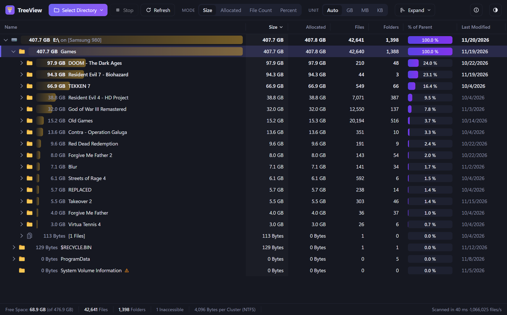
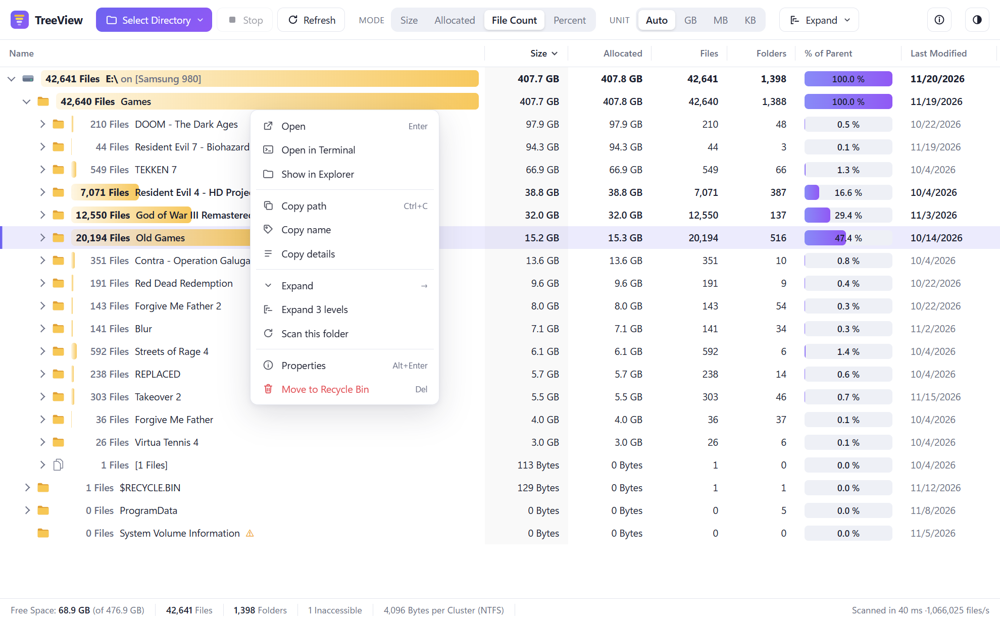
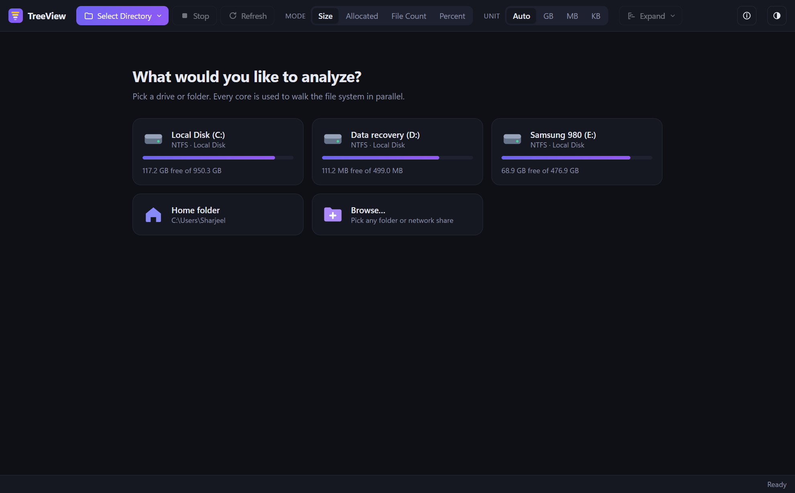
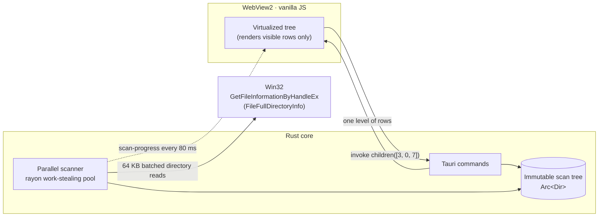

<div align="center">


# TreeView

**A blazing-fast disk space analyzer for Windows, written in Rust.**

Point it at a drive or folder and see exactly where your space went: millions of files, in seconds, in an expandable tree you can sort, explore, and act on.

[](https://github.com/sharjeel619/TreeView/releases/latest)
[](https://github.com/sharjeel619/TreeView/actions/workflows/ci.yml)
[](LICENSE)


[**Download**](https://github.com/sharjeel619/TreeView/releases/latest) · [Features](#features) · [Performance](#performance) · [Architecture](#architecture) · [Build from source](#building-from-source)

<br />



</div>

---

## Why TreeView

Disk analyzers live or die on two things: **how fast they walk the file system** and **how quickly you can read the answer**. TreeView is engineered for both:

- **~410,000 files per second** on a warm cache. A 835 GB system drive with 4.7 million files and 669,000 folders is fully indexed in under 12 seconds.
- **Exact "size on disk"**, not an estimate. Allocated size comes straight from NTFS for every file, without opening a single one.
- **Instant UI at any scale.** The tree is fetched lazily and rendered virtually, so expanding a folder with 100,000 children feels the same as one with ten.
- **8.7 MB, single executable, zero dependencies** beyond the WebView2 runtime that ships with Windows.

## Features

| | |
|---|---|
| 🌳 **Hierarchical tree** | Expand any folder; every row shows size, allocated size, file and folder counts, % of parent, and last modified. |
| 📊 **Four analysis modes** | Size · Allocated · File Count · Percent. Inline bars, bolding and percentages all follow the active mode. |
| 📐 **Unit control** | Automatic, or pinned to GB / MB / KB for easy comparison. |
| ↕️ **Sortable, resizable columns** | Click to sort any column (sorting applies at every level); drag the edges to resize. |
| 🗂️ **Loose-file grouping** | Files inside a folder are grouped as `[N Files]` so folders stay readable; expand the group to see each file. |
| ⚡ **Live progress** | Files, folders, bytes and throughput update in real time; stop at any moment and keep the partial results. |
| 🖱️ **Rich context menu** | Open, Open with…, Open in Terminal, Show in Explorer, Copy path / name / details, Expand 3 levels, Scan this folder, Properties, **Move to Recycle Bin**. |
| ♻️ **Safe deletion** | Recycle Bin only, behind an explicit confirmation; the tree and every ancestor total update in place, with no rescan needed. |
| 💽 **Drive overview** | Start screen lists every volume with label, file system, and usage; the status bar shows free space and cluster size. |
| ⌨️ **Keyboard-first** | Full arrow-key navigation, `Enter`, `Del`, `Ctrl+C`, `Alt+Enter`, `Shift+F10`, `F5`, `Esc`. |
| 🌗 **Light & dark themes** | Follows the system theme by default; one click to switch. |

<table>
  <tr>
    <td></td>
    <td></td>
  </tr>
  <tr>
    <td align="center"><sub>File-count mode, light theme, context menu</sub></td>
    <td align="center"><sub>Drive picker</sub></td>
  </tr>
</table>

## Performance

Measured on the author's laptop with the shipping release build (Intel Core i7-12700H, 14 cores / 20 threads, 16 GB RAM, Windows 11 Pro 23H2).

| Target | Storage | Files | Folders | Data | Cold cache | Warm cache |
|---|---|---:|---:|---:|---:|---:|
| `C:\` (system drive) | Micron MTFDKBA1T0TFH (NVMe) | 4,721,751 | 668,994 | 835 GB | 70.3 s | **11.6 s** |
| `E:\` (games drive) | Samsung MZVL2512HDJD (NVMe) | 42,641 | 1,398 | 408 GB | n/a | **40 ms** |

- **Throughput:** ~408,000 files/s warm on the system drive and ~1,000,000 files/s on the games drive.
- **Memory:** ~660 MB working set with the full 4.7-million-entry tree resident, about 140 bytes per file system entry.
- **Accuracy:** totals match a leading commercial analyzer byte-for-byte (size *and* allocated size) on every folder of the test drive.

> A cold scan is bound by the SSD and the NTFS metadata cache; a warm scan is bound by the CPU. TreeView saturates both.

## Installation

Grab the latest build from the [**Releases**](https://github.com/sharjeel619/TreeView/releases/latest) page:

| File | Use it when |
|---|---|
| `TreeView_1.0.0_x64-setup.exe` | You want a normal install with a Start-menu entry and an uninstaller. |
| `TreeView-1.0.0-portable.exe` | You want a single file you can run from anywhere, no install. |

**Requirements:** Windows 10 or 11 (x64) and the Microsoft Edge WebView2 Runtime, which is preinstalled on all supported versions of Windows.

> The binaries are not code-signed yet, so Windows SmartScreen may show a warning on first launch. Choose **More info → Run anyway**, or build from source.

## Usage

1. Pick a drive, your home folder, or **Browse…** for any folder or network share.
2. Expand folders with the chevron, double-click, or `→`. Switch mode and units from the toolbar.
3. Right-click any row for actions. Run as administrator to include protected system folders.

<details>
<summary><b>Keyboard shortcuts</b></summary>

| Key | Action |
|---|---|
| `↑` `↓` `PgUp` `PgDn` `Home` `End` | Move selection |
| `→` / `←` | Expand / collapse (or jump to parent) |
| `Enter` | Open file · toggle folder |
| `Alt+Enter` | Windows Properties |
| `Del` | Move to Recycle Bin (with confirmation) |
| `Ctrl+C` | Copy full path |
| `Shift+F10` / `Menu` | Context menu |
| `F5` | Rescan |
| `Esc` | Stop scan · close menus |

</details>

## Architecture



### Design decisions

**1. Batched directory enumeration.** The classic `FindFirstFile`/`FindNextFile` loop returns one entry per call and no allocation size, so tools either guess "size on disk" or open every file. TreeView opens each directory once and calls `GetFileInformationByHandleEx(FileFullDirectoryInfo)`, which fills a 64 KB buffer with hundreds of entries at a time, each carrying `EndOfFile`, `AllocationSize`, `LastWriteTime` and attributes. That means fewer syscalls *and* exact allocated sizes.

**2. Oversubscribed work-stealing.** Directory traversal is latency-bound I/O, not compute. The scanner recurses with rayon's `par_iter` over subdirectories on a dedicated pool sized at **2× logical cores**, which keeps NVMe queue depth high while work-stealing balances both deep and wide trees automatically. Progress counters are relaxed atomics updated once per directory, never per file.

**3. Lazy, index-addressed IPC.** The multi-million-node tree never crosses the JS bridge wholesale. After a scan, the tree is frozen behind an `Arc`, and the UI asks for exactly one level at a time by *index path* (e.g. `[3, 0, 7]`). Lookups are `O(depth)`, payloads stay small, and indices are stable because the tree is immutable.

**4. Virtualized rendering.** Only rows inside the viewport exist in the DOM (about 40 at a time), redrawn in a single `requestAnimationFrame`. Expanding 100,000 rows costs one array flatten, not 100,000 DOM nodes.

**5. Correct by construction.**
- **Junctions and symlinks** are never followed, so there are no infinite loops and nothing is counted twice.
- **MFT-resident files** (tiny files stored inside the file table) report 0 bytes allocated, matching NTFS reality.
- **Access-denied folders** are flagged ⚠ and counted in the status bar, never silently dropped.
- **Cancelling** a scan returns the partial tree, and a superseded scan can never overwrite a newer one.
- **Deletion** always goes through the Windows shell's Recycle Bin. If an item is too large to recycle, Windows asks before destroying it.

**6. Zero-build frontend.** No bundler, no `node_modules`, no framework. The UI is three static files embedded into the binary at compile time, which keeps the attack surface, the build, and the download small.

## Project structure

```
TreeView/
├── src-tauri/
│   ├── src/
│   │   ├── scan.rs        # Parallel scanner, Win32 enumeration, volume info, tests
│   │   └── main.rs        # Tauri commands: scan, tree queries, shell actions
│   ├── icons/             # App icons
│   ├── Cargo.toml
│   └── tauri.conf.json
├── ui/
│   ├── index.html         # Shell: toolbar, tree, dialogs
│   ├── style.css          # Design tokens, light/dark themes
│   └── app.js             # Tree model, virtualized renderer, interactions
└── docs/                  # README assets
```

## Building from source

**Prerequisites:** [Rust](https://rustup.rs) (stable, MSVC toolchain) and Windows 10/11. No Node.js required.

```powershell
git clone https://github.com/sharjeel619/TreeView.git
cd TreeView/src-tauri

cargo build --release          # → target/release/treeview.exe
cargo test  --release          # scanner tests: totals, sorting, junction safety
```

To produce the installer:

```powershell
cargo install tauri-cli --version "^2" --locked
cargo tauri build              # → target/release/bundle/nsis/TreeView_1.0.0_x64-setup.exe
```

## Known limitations

- **Windows only.** The scanner is built directly on Win32 enumeration APIs for speed.
- **Protected folders need elevation.** Folders like `System Volume Information` are reported as inaccessible unless TreeView runs as administrator.
- **Hard links** are counted once per link, the same way Explorer counts them.

## Roadmap

- [ ] Rescan a single subtree in place
- [ ] Export to CSV / Excel
- [ ] Treemap visualization
- [ ] Direct MFT reading when elevated, for even faster cold scans
- [ ] File-type breakdown and search / filter
- [ ] Code-signed releases and auto-update

## Contributing

Issues and pull requests are welcome. For anything non-trivial, please open an issue first to discuss the approach. Before submitting, make sure `cargo test --release` passes and the app builds with `cargo build --release`.

## Author

**Sharjeel Imtiaz**: [GitHub](https://github.com/sharjeel619) · [Portfolio](https://sharjeel.netlify.app) · [Email](mailto:imtiazsharjeel@gmail.com)

## License

Released under the [MIT License](LICENSE).
